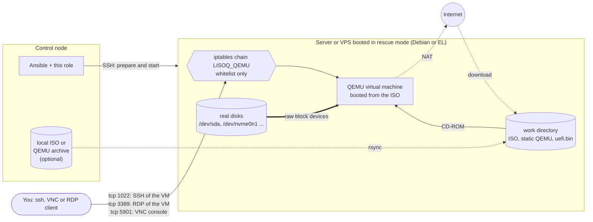
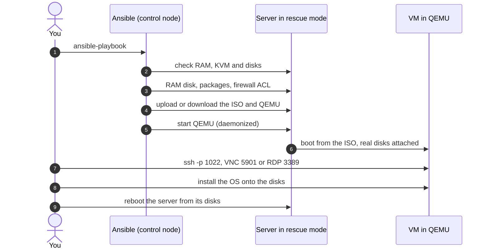
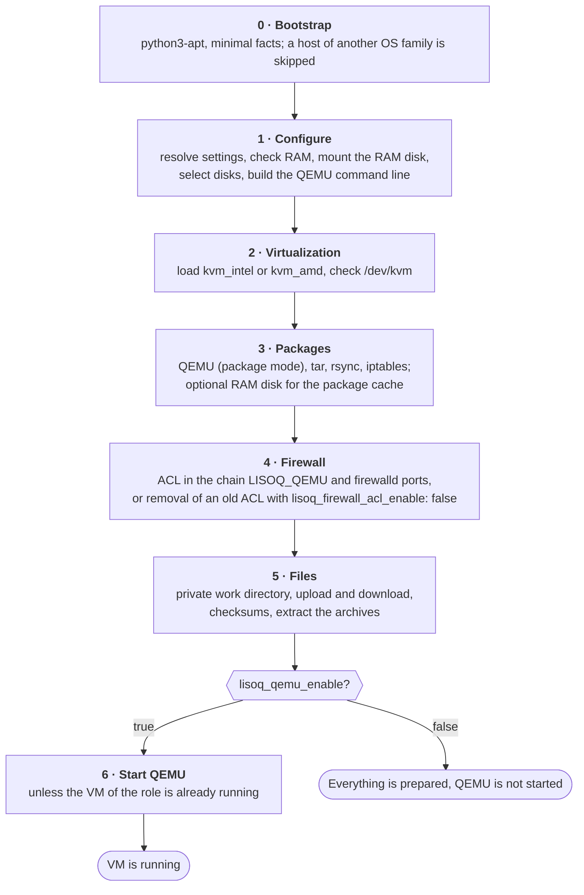
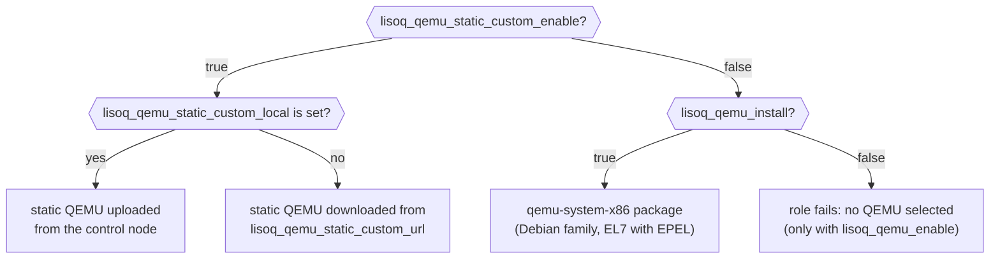
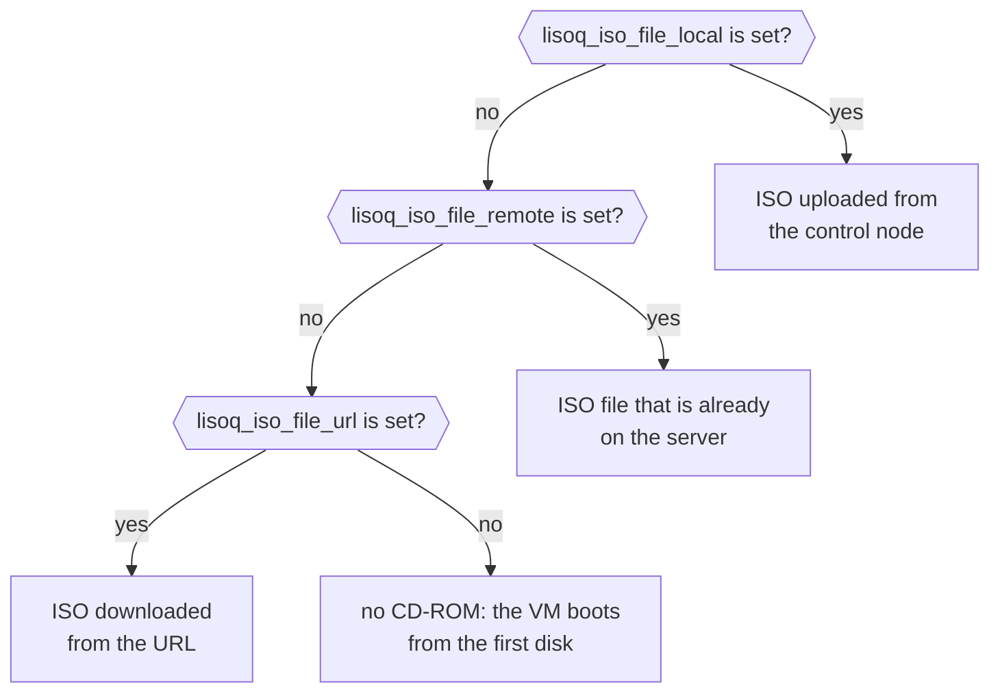
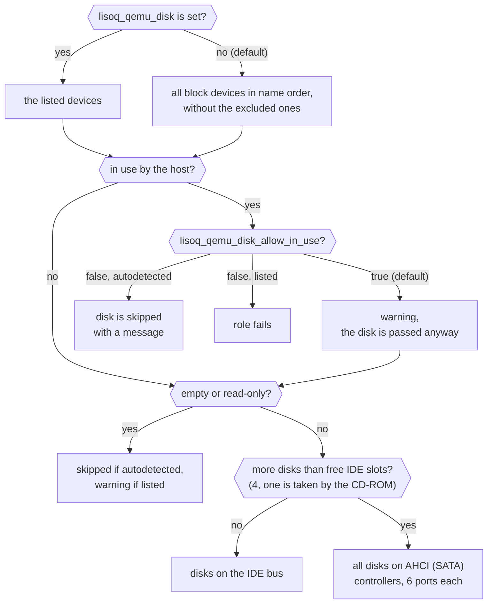
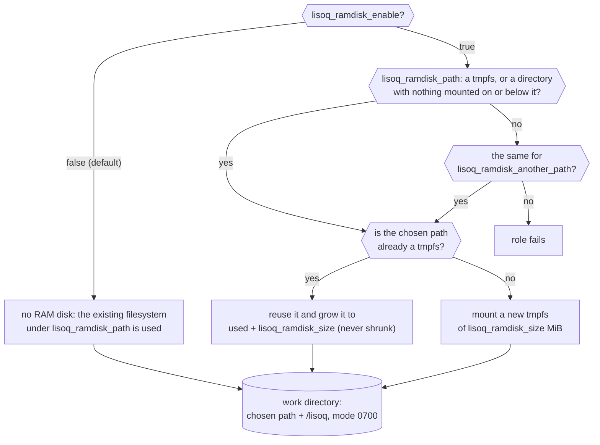
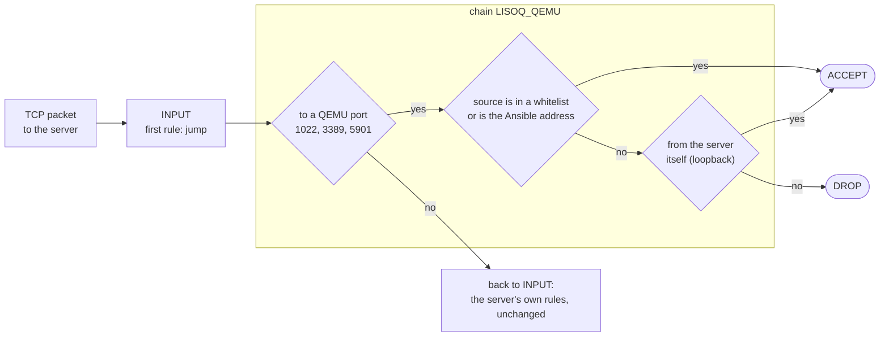
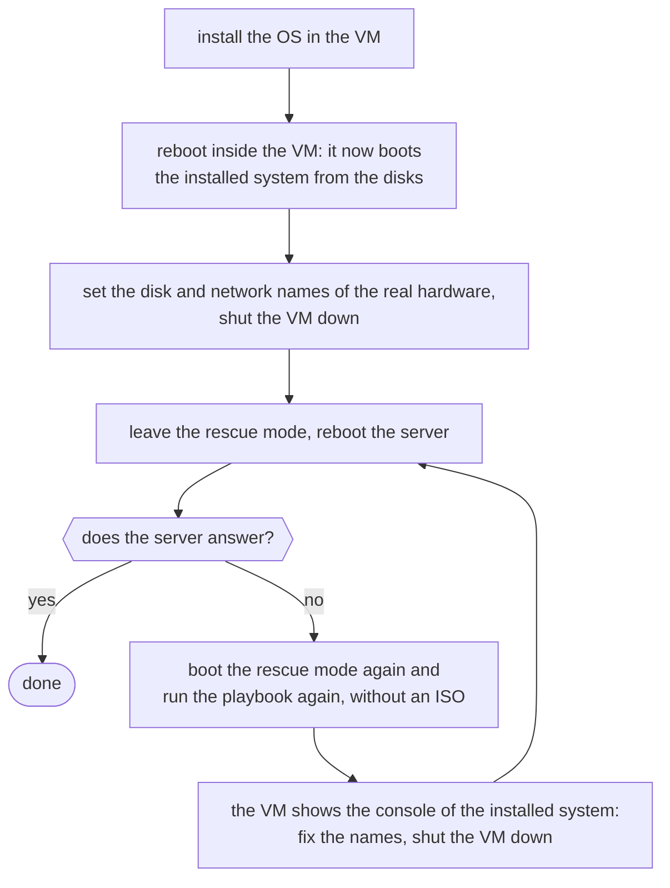

# linux_run_iso_in_qemu

[](https://github.com/click0/ansible-linux-run-iso-in-qemu/actions/workflows/ci.yml)
[](https://github.com/click0/ansible-linux-run-iso-in-qemu/releases)
[](https://galaxy.ansible.com/click0/linux_run_iso_in_qemu/)
[](LICENSE)

Install **any operating system from its own ISO** on a dedicated server or a VPS that the hoster only lets you
boot into a Linux rescue system.

The role starts [QEMU](https://www.qemu.org/) inside the rescue system, attaches the ISO as a CD-ROM and passes the
**real disks** of the server to the virtual machine. You connect to the VM over SSH, VNC or RDP, run the installer
(or a live / diagnostic system) and it writes straight to the server's disks. Then you reboot the server from them.



## Contents

- [Why](#why)
- [Who it is for](#who-it-is-for)
- [Quick start](#quick-start)
- [Requirements](#requirements)
- [How the role works](#how-the-role-works)
- [Variables](#variables)
  - [Start and QEMU source](#start-and-qemu-source)
  - [The ISO](#the-iso)
  - [VM hardware and boot](#vm-hardware-and-boot)
  - [Ports and console](#ports-and-console)
  - [Disks](#disks)
  - [RAM disk and work directory](#ram-disk-and-work-directory)
  - [RAM disk for the package cache](#ram-disk-for-the-package-cache)
  - [Firewall ACL](#firewall-acl)
  - [Checksums](#checksums)
- [Example playbooks](#example-playbooks)
- [After the run](#after-the-run)
- [Device names: the VM and the real hardware](#device-names-the-vm-and-the-real-hardware)
- [Console of an installed system](#console-of-an-installed-system)
- [Good to know](#good-to-know)
- [Tested and TODO](#tested-and-todo)
- [License, author, contributing](#license-author-contributing)

## Why

Many datacenters and hosters no longer let you install an OS from your own media (ISO image), and offer very little
choice: Debian, Ubuntu, CentOS and little else. Almost all of them still have a **rescue mode**: a small Linux booted
from the network, with SSH access and the server's disks untouched.

This role turns that rescue system into an installation host:

- the ISO can be an OS installer, a diagnostic disk or any other live system
  ([Live-CD](https://en.wikipedia.org/wiki/Live_CD)): FreeBSD (mfsbsd is the default), Windows PE, Linux, ...
- the ISO comes from the machine that runs Ansible, from the server itself or from an ftp/http(s) URL;
- QEMU comes from the package repository of the rescue system, or as a universal Linux binary with statically
  compiled libraries (works on any rescue system, nothing is installed);
- the VM has Internet access through QEMU user networking (NAT);
- the forwarded ports are protected by a whitelist in `iptables`.

A run from start to finish:



## Who it is for

The role is an **IP-KVM with virtual media, done in software**. It is for dedicated servers and VPS where the hoster
gives you no IP-KVM (or only for an hour, on request) and no way to attach your own ISO: just a rescue system.

| You want to | How the VM is booted | Typical cases |
|---|---|---|
| Install an OS the hoster does not offer | from an ISO | FreeBSD on a VPS or a dedicated server (mfsbsd is the default ISO); Windows from an installation ISO or a WinPE such as Sergei Strelec, over VNC and RDP; OpenBSD, OPNsense, your own Linux image |
| See the console of a system that is already installed | from the server's disks, without an ISO | a Proxmox host, or any server, that does not come back after an upgrade: boot loader, kernel panic, initramfs prompt, ZFS import, network settings; typing a disk encryption passphrase; checking that a fresh install boots before you leave the rescue mode |
| Repair a system or its disks with better tools than the hoster's rescue system has | from a rescue ISO | SystemRescue, Grml or Finnix for Linux; WinPE Sergei Strelec for Windows |

On a VPS there is usually no nested virtualization: QEMU then runs without KVM, in software emulation. An
installation still works, only slower; on a small VPS lower `lisoq_qemu_ram`.

Two things to keep in mind, both described below: the system in the VM sees
[other device names](#device-names-the-vm-and-the-real-hardware) than on the real hardware, and a system booted
from the disks in the VM [is the real system](#console-of-an-installed-system), with its real data.

## Quick start

1. Install the role and the collection it needs on the control node:

   ```shell
   ansible-galaxy role install click0.linux_run_iso_in_qemu
   ansible-galaxy collection install ansible.posix
   ```

2. Boot the server into the hoster's rescue mode and write a playbook:

   ```yaml
   - hosts: rescue_servers
     roles:
       - role: click0.linux_run_iso_in_qemu
         vars:
           lisoq_qemu_enable: true                # start QEMU (off by default)
           lisoq_qemu_static_custom_enable: true  # universal static QEMU, works everywhere
   ```

   The role needs root on the server. Rescue systems usually log you in as root; otherwise add `become: true`.

3. Run it. With the defaults the role downloads the mfsbsd 14.2 ISO, passes all disks of the server to the VM and
   boots it:

   ```shell
   ansible-playbook -i inventory playbook.yml
   ```

4. Connect to the VM from the machine that ran Ansible (its address is whitelisted automatically):

   ```shell
   ssh -p 1022 root@SERVER        # SSH of the system booted from the ISO (mfsbsd: password mfsroot)
   ```

   The VNC console listens on `127.0.0.1` of the server by default; reach it through an SSH tunnel:

   ```shell
   ssh -L 5901:127.0.0.1:5901 root@SERVER    # then open a VNC viewer on 127.0.0.1:5901
   ```

> [!WARNING]
> By default **all disks of the server are passed to the VM**, also disks the rescue system itself uses (mounted,
> swap, md, LVM, ZFS ...). Writing to a disk from the host and from the VM at the same time corrupts it.
> Read [Disks](#disks) before you run the role on a server with data.

## Requirements

**Target server**

| Target system | QEMU from the package | Static QEMU | Notes |
|---|:---:|:---:|---|
| Debian, Ubuntu and other Debian-family systems | yes | yes | |
| CentOS / EL 7 | yes (EPEL) | yes | control node needs ansible-core 2.15 or 2.16: newer versions do not support its Python |
| AlmaLinux, Rocky and other EL 8 | no | yes | control node needs ansible-core 2.15 or 2.16 as well (system Python 3.6); no `qemu-system-x86` package, and `qemu-kvm` supports neither the `pc` machine nor IDE disks |
| AlmaLinux, Rocky and other EL 9 | no | yes | no `qemu-system-x86` package; `qemu-kvm` supports neither the `pc` machine nor IDE disks |

- `python3` (on Debian-family systems the role installs `python3-apt` itself, also when Python is missing);
- at least 512 MiB of RAM, see [`lisoq_total_need_ram`](#ram-disk-and-work-directory);
- root access (directly or with become);
- hosts of another OS family are skipped with a message.

**Control node**

- ansible-core 2.15 or newer (tested with 2.15 and 2.19);
- collection `ansible.posix` >= 1.5.0;
- `rsync`, only to upload local files (`lisoq_iso_file_local`, `lisoq_qemu_static_custom_local`);
- `sshpass`, only if you upload local files and log in to the server with a password.

Local files are uploaded as the user Ansible logs in as, without sudo: with a password through `rsync` + `sshpass`,
without one through `ansible.posix.synchronize`. The password must be in a variable (`ansible_password` or
`ansible_ssh_pass`): a password typed with `--ask-pass` is not visible to the role.

## How the role works



Things worth knowing about a run:

- **It is safe to re-run.** A VM started by the role is recognised by `-name lisoq` and is never restarted; stop it
  to apply new settings. Files that are already in place are not transferred again.
- **KVM is used when available** (`vmx` / `svm` CPU flag and `/dev/kvm`). Without it, e.g. on a VPS without nested
  virtualization, QEMU still runs, in slow software emulation.
- **The role does not change anything on the disks** and does not unmount or stop anything on the host.
- **Your variables are never modified.** Derived values are kept in internal `__lisoq_*` facts, so a setting passed
  with `-e` is applied the same way as one from a vars file.

## Variables

All variables with their defaults are in [`defaults/main.yml`](defaults/main.yml). They can be set in any usual way:
inventory, play `vars` / `vars_files`, role `vars` or params, `include_role` `vars`, or extra vars (`-e`).

### Start and QEMU source

| Variable | Default | Meaning |
|---|---|---|
| `lisoq_qemu_enable` | `false` | Start QEMU. With `false` the role prepares everything (packages, RAM disk, firewall, downloads) but does not start it |
| `lisoq_qemu_static_custom_enable` | `false` | Use the universal Linux QEMU binary with statically compiled libraries. Takes precedence over `lisoq_qemu_install` |
| `lisoq_qemu_static_custom_local` | `''` | Path on the control node to the static QEMU archive (tar.gz); it is uploaded to the server |
| `lisoq_qemu_static_custom_url` | `https://support.org.ua/Soft/vKVM/orig/vkvm.tar.gz` | URL of the static QEMU archive, used when `_local` is empty |
| `lisoq_qemu_static_custom_relative_dir` | `/share/qemu/` | Path inside the archive to the auxiliary files (BIOS, keymaps). Slashes at the ends are optional; empty means `share/qemu` |
| `lisoq_qemu_install` | `false` | Install QEMU (`qemu-system-x86`) from the package repository |
| `lisoq_qemu_args` | see below | Base QEMU command line arguments |



- Since 1.2.1 `lisoq_qemu_enable` is enforced: before, QEMU was started regardless of it. Set it to `true`
  explicitly.
- Mirrors of the default static QEMU archive are listed in [`defaults/main.yml`](defaults/main.yml).
- The default `lisoq_qemu_args`:

  ```yaml
  lisoq_qemu_args: '
   -net nic
   -rtc base=localtime
   -M pc
   -vga std
   -daemonize
  '
  ```

  `-daemonize` is added if it is missing: without it QEMU would stay in the foreground and the role would never
  finish. The role appends everything else itself (network, CD-ROM, CPU, RAM, disks, VNC, boot order, KVM).

### The ISO

| Variable | Default | Meaning |
|---|---|---|
| `lisoq_iso_file_local` | `''` | Full path to the ISO on the control node. Symlinks and mounted shares work |
| `lisoq_iso_file_remote` | `''` | Path to an ISO that is already on the server |
| `lisoq_iso_file_url` | `https://mfsbsd.vx.sk/files/iso/14/amd64/mfsbsd-14.2-RELEASE-amd64.iso` | URL of the ISO; it is downloaded to the work directory |
| `lisoq_iso_file_ssh_port` | `22` | Port of the sshd _inside_ the system booted from the ISO; `lisoq_qemu_args_port_ssh` is forwarded to it |



The first one that is set wins: local, then remote, then URL. To use your own ISO it is enough to set
`lisoq_iso_file_local` or `lisoq_iso_file_remote`; the default URL is then ignored.

**Which ISO to use.** Any bootable ISO works. Some that fit this job well:

| For | ISO | How you get in |
|---|---|---|
| FreeBSD: installation | [mfsbsd](https://mfsbsd.vx.sk/), the default | SSH on port 1022 as `root`, password `mfsroot`; `zfsinstall` is included |
| Windows: installation, repair, disk and password tools | [WinPE 10-8 Sergei Strelec](https://sergeistrelec.name/), or a Windows installation ISO | graphical desktop over VNC |
| Linux: rescue, filesystem and boot loader repair, installation by hand | [SystemRescue](https://www.system-rescue.org/) | VNC console; for SSH add the boot options `rootpass=PASSWORD nofirewall` |
| Linux: the same, Debian based | [Grml](https://grml.org/) | VNC console; the boot option `ssh=PASSWORD` starts sshd |
| Linux: the same, small and text only | [Finnix](https://www.finnix.org/) | VNC console |
| Partitioning | [GParted Live](https://gparted.org/livecd.php) | graphical desktop over VNC |

- Boot options are typed in the boot menu of the ISO, on the VNC console.
- WinPE Sergei Strelec is a third-party WinPE build with a large set of tools, several GB in size: give the RAM disk
  enough room (see the [second example](#example-playbooks)) and mind the licences of the tools you use.
- For service ISOs set `lisoq_qemu_boot_once_cd: false`, so that every reboot of the VM starts the ISO again.

### VM hardware and boot

| Variable | Default | Meaning |
|---|---|---|
| `lisoq_qemu_ram` | `1024` | RAM of the VM in MiB, at least 256 |
| `lisoq_qemu_cpu` | `''` | Number of CPUs of the VM. Empty: all CPUs of the server, but at most 255 (the limit of the `pc` machine; QEMU does not start with more) |
| `lisoq_qemu_uefi` | `false` | Boot the VM with UEFI firmware (`-bios uefi.bin`) instead of the default BIOS (SeaBIOS) |
| `lisoq_qemu_static_custom_uefi_url` | `https://support.org.ua/Soft/vKVM/orig/uefi.tar.gz` | UEFI firmware archive (`uefi.bin`) used with `lisoq_qemu_uefi: true` |
| `lisoq_qemu_boot_cd` | `true` | Boot the VM from the CD-ROM (the ISO). With `false` it boots from the first disk |
| `lisoq_qemu_boot_once_cd` | `true` | Boot from the CD-ROM only _once_: after a `reboot` inside the VM it boots from the disks |

- `lisoq_qemu_uefi` requires `lisoq_qemu_static_custom_enable: true`. Enable it only if the OS must be installed or
  booted in UEFI mode, and only with an ISO that supports UEFI boot (the default mfsbsd 14.2 ISO does, older
  mfsbsd 12.x ISOs do not). Disks larger than 2 TiB are fully usable in BIOS mode as well.
- Set `lisoq_qemu_boot_once_cd: false` for service CDs with many tools, where you reboot the VM often and want the
  CD every time.

### Ports and console

| Variable | Default | Meaning |
|---|---|---|
| `lisoq_qemu_args_port_ssh` | `1022` | Port on the server forwarded to the SSH port of the VM (`lisoq_iso_file_ssh_port`). Empty: no forwarding |
| `lisoq_qemu_args_port_rdp` | `3389` | Port on the server forwarded to port `3389` of the VM (RDP). Empty: no forwarding |
| `lisoq_qemu_args_port_vnc` | `5901` | Port of the VNC console of the VM (screen and keyboard). Values below 5900 mean 5901 |
| `lisoq_qemu_vnc_type` | `local` | `local`: VNC listens on `127.0.0.1` only. `share`: on all addresses |

- The SSH and RDP ports are forwarded **over IPv4 only**: QEMU user networking takes no IPv6 address for them.
- With `lisoq_qemu_vnc_type: share` newer QEMU (e.g. 10.0) listens on IPv6 too; the static QEMU 2.2 listens on
  IPv4 only.
- Without both forwarded ports the VM still has the user network (NAT) and Internet access; only the VNC port is
  reachable from outside.

### Disks

| Variable | Default | Meaning |
|---|---|---|
| `lisoq_qemu_disk` | `''` | Block devices passed to the VM. Empty: autodetect all disks of the server |
| `lisoq_qemu_disk_allow_in_use` | `true` | Pass also the disks in use by the host, with a warning. `false`: safe mode |
| `lisoq_qemu_exclude_disk` | `['fd0', 'sr0']` | Devices that autodetection never takes |
| `lisoq_qemu_exclude_disk_regular_list` | `fd`, `sr`, `dm-`, `loop`, `ram`, `zram`, `nbd`, `md`, `zd`, `bcache` | Device name prefixes (without the number) that autodetection never takes; the role builds a regular expression from them |



- `lisoq_qemu_disk` is a list, or a string such as `'sda,sdb'`; the `/dev/` prefix is optional. It may also name
  partitions or other block devices:

  ```yaml
  lisoq_qemu_disk:
    - 'sda'
    - 'sdb'
  ```

- A disk is **in use by the host** when the disk or anything on it is mounted or used as swap, when an active md
  array, LVM volume, dm-crypt / multipath or bcache device sits on it, or when it belongs to an imported ZFS pool or
  to a mounted btrfs filesystem (also the members of a multi-device btrfs that `lsblk` shows without a mount point).
- With the default `lisoq_qemu_disk_allow_in_use: true` such disks are passed to the VM and the role only prints a
  warning with their names. Writing to a disk from the host and from the VM at the same time corrupts it (an active
  md array writes even when not mounted, e.g. during a resync), so stop what uses them on the host first. Rescue
  systems often assemble md arrays and activate LVM automatically:

  ```shell
  mdadm --stop --scan
  vgchange -an
  zpool export POOL
  ```

- On an installed (not rescue) system the host's own system disk is passed to the VM as well.
- With `lisoq_qemu_disk_allow_in_use: false` (safe mode) autodetected disks in use are skipped with a message, and
  if such a disk is listed explicitly in `lisoq_qemu_disk`, the role fails.
- Empty and read-only devices (an empty card reader, an IPMI virtual floppy) cannot be opened by QEMU: autodetected
  ones are left out, listed ones get a warning.
- Up to three disks (four without an ISO) go to the IDE bus, as the `pc` machine has four IDE slots. More disks are
  all attached to AHCI (SATA) controllers; AHCI drivers are built into Windows, Linux and FreeBSD, and SeaBIOS boots
  from it.

### RAM disk and work directory

| Variable | Default | Meaning |
|---|---|---|
| `lisoq_ramdisk_enable` | `false` | Create (or reuse) a RAM disk (tmpfs) for the files of the role |
| `lisoq_ramdisk_path` | `/mnt` | Preferred mount point of the RAM disk |
| `lisoq_ramdisk_another_path` | `/tmp` | Alternative mount point, used when the preferred one is taken |
| `lisoq_ramdisk_size` | `250` | Size of the RAM disk in MiB |
| `lisoq_total_need_ram` | `''` | Minimum RAM of the server in MiB. Empty: `lisoq_ramdisk_size` + `lisoq_qemu_ram`, at least 300 |



- The role keeps its files (ISO, QEMU archives, `uefi.bin`) in the `lisoq` subdirectory of the chosen path. It is
  private (mode 0700), because the path itself may be world-writable. It is owned by the user the role runs as, or by
  the SSH login user when local files are uploaded (they are uploaded without become); a directory owned by either of
  them is reused. If it exists and belongs to someone else or is writable by others, the role stops: remove it and
  re-run.
- The alternative path is used when `lisoq_ramdisk_path` is already mounted with another filesystem or has a
  filesystem mounted below it (e.g. a server disk on `/mnt` or `/mnt/data` in rescue mode; a tmpfs on top would hide
  it).
- A missing mount point is created with mode 0755; the mode of an existing one is not changed.
- The ramdisk paths must not contain spaces.
- Size the RAM disk for what goes into it: the ISO, plus the static QEMU archive and its extracted files.
- RAM checks: the role requires at least 512 MiB of RAM on the server (and `lisoq_total_need_ram`), and 256 MiB of
  free RAM for QEMU.

### RAM disk for the package cache

| Variable | Default | Meaning |
|---|---|---|
| `lisoq_ramdisk_package_enable` | `false` | Mount a RAM disk on the package cache (`/var/cache/apt`, `/var/cache/yum` or `/var/cache/dnf`) before packages are installed |
| `lisoq_ramdisk_package_size` | `''` | Its size in MiB. Empty: autodetect (empirically at least 300 MiB are needed) |
| `lisoq_ramdisk_package_purge` | `false` | Unmount it after the packages are installed, to free the RAM |

Not every live system has 200-400 MB of free space for the package lists and downloads; this puts them into RAM.
After a purge the package cache directory is left empty; installing packages later (or re-running the role) still
works.

### Firewall ACL

| Variable | Default | Meaning |
|---|---|---|
| `lisoq_firewall_acl_enable` | `true` | Allow the QEMU ports (SSH, RDP, VNC) only from the whitelists; drop everyone else |
| `lisoq_firewall_acl_allow_ansible_ip` | `true` | Also allow the address the Ansible control node connects from |
| `lisoq_firewall_acl_ipv4_white` | `['127.0.0.0/8']` | IPv4 addresses and networks that may connect |
| `lisoq_firewall_acl_ipv6_white` | `['::1/128']` | IPv6 addresses and networks that may connect |



- The rules apply only to the QEMU ports, not to the server's own SSH. Without the ACL anyone could reach the SSH of
  the VM, and live ISOs such as mfsbsd have a well-known root password; this is why it is enabled by default since
  1.4.0.
- Both whitelists accept a list, a string such as `'10.0.0.0/8,192.168.1.0/24'`, or an empty value (nobody).
- Connections from the server itself (loopback, e.g. an SSH tunnel to the VNC port) are always allowed, also when
  the whitelists do not contain `127.0.0.0/8`.
- The Ansible address is the client IP from `SSH_CONNECTION`, as the server sees it. If it cannot be detected (e.g.
  a local connection), only the whitelists are used and a message is printed.
- If Ansible connects over **IPv6**, add the IPv4 address you will connect from to `lisoq_firewall_acl_ipv4_white`:
  the SSH and RDP ports are forwarded over IPv4 only. The role prints a message in this case.
- While a QEMU started by the role is still running, its ports stay protected too, even if the port settings have
  changed.
- If IPv6 is enabled but `ip6tables` does not work, the role fails instead of leaving the ports open over IPv6.
- `lisoq_firewall_acl_enable: false` removes the `LISOQ_QEMU` chain left by an earlier run.
- **firewalld** is left running. The QEMU ports are opened in its runtime configuration (default zone), because with
  its nftables backend (EL8+) it would otherwise reject the whitelisted clients too. `firewall-cmd --reload` closes
  them again until the role is re-run. Other nftables rulesets that drop these ports must allow them themselves.

### Checksums

| Variable | Default | Meaning |
|---|---|---|
| `lisoq_checksum_enable` | `false` | Verify the checksums of the ISO and of the static QEMU and UEFI archives |
| `lisoq_iso_file_checksum` | sha256 of the default ISO | Checksum of the ISO (URL, local or remote) |
| `lisoq_qemu_static_custom_checksum` | sha256 of the default archive | Checksum of the static QEMU archive (URL or local) |
| `lisoq_qemu_static_custom_uefi_checksum` | sha256 of the default archive | Checksum of the UEFI archive |

- The format is `<algorithm>:<hex digest>` (`md5`, `sha1`, `sha224`, `sha256`, `sha384`, `sha512`). For files
  downloaded from a URL also `<algorithm>:<URL of a checksum file>` in the `sha256sum` format (as `get_url` accepts).
- With `lisoq_checksum_enable: true` the role fails on a mismatch, and also when the checksum of a file it uses is
  empty. If you change a file, set its checksum too.
- The defaults are the checksums of the default files: the ISO one is published by mfsbsd, the archives from
  support.org.ua have no published checksums (the files on the mirrors may differ).
- Files are verified on the server before they are used. With checksums, the archives are downloaded to the work
  directory first and extracted from there, again only when the archive changes.

## Example playbooks

### Static QEMU, ISO from a URL, VNC open to the whitelist

```yaml
- hosts: rescue_servers
  vars_files:
    - vars/main.yml
  roles:
    - click0.linux_run_iso_in_qemu
```

`vars/main.yml`:

```yaml
lisoq_qemu_enable: true
lisoq_qemu_static_custom_enable: true
lisoq_iso_file_url: 'https://mfsbsd.vx.sk/files/iso/14/amd64/mfsbsd-14.2-RELEASE-amd64.iso'
lisoq_qemu_vnc_type: 'share'
lisoq_qemu_boot_once_cd: false
lisoq_qemu_ram: '650'
lisoq_ramdisk_package_enable: false
lisoq_ramdisk_package_purge: false
lisoq_firewall_acl_ipv4_white:
  - '127.0.0.0/8'
  - '10.0.0.0/8'
  - '192.168.0.0/16'
lisoq_firewall_acl_ipv6_white: []
lisoq_firewall_acl_enable: true
```

### QEMU from the package, a local Windows PE ISO in a RAM disk

```yaml
- hosts: rescue_servers
  vars_files:
    - vars/main.yml
  roles:
    - click0.linux_run_iso_in_qemu
```

`vars/main.yml`:

```yaml
lisoq_qemu_enable: true
lisoq_qemu_install: true
lisoq_qemu_ram: '1000'
lisoq_qemu_cpu: '2'
lisoq_iso_file_local: '../../files/ISO images/WinPE10_8_Strelec_2022.01.04.iso'
lisoq_qemu_vnc_type: 'share'
lisoq_ramdisk_enable: true
lisoq_ramdisk_size: '4100'
lisoq_firewall_acl_ipv4_white:
  - '127.0.0.0/8'
  - '10.0.0.0/8'
  - '192.168.0.0/16'
lisoq_firewall_acl_enable: true
```

## After the run

| What | How |
|---|---|
| SSH into the VM | `ssh -p 1022 root@SERVER` |
| VNC console, `lisoq_qemu_vnc_type: local` | `ssh -L 5901:127.0.0.1:5901 root@SERVER`, then a VNC viewer on `127.0.0.1:5901` |
| VNC console, `lisoq_qemu_vnc_type: share` | a VNC viewer on `SERVER:5901` from a whitelisted address |
| RDP (Windows in the VM) | an RDP client on `SERVER:3389` |
| Stop the VM | shut the system down inside the VM, or on the server: `pkill -f 'name liso[q]'` |
| Apply new settings | stop the VM, then run the playbook again |
| Boot the installed OS | leave the rescue mode in the hoster's panel and reboot the server |

## Device names: the VM and the real hardware

Inside the VM the OS sees emulated hardware, always the same. The real server has other controllers and network
cards, so the names of the disks and of the network card differ. An OS installed in the VM must be configured for
the **real** names before the server is rebooted from its disks, or it comes up without its disks or without network.

| | In the VM | On the real server (examples) |
|---|---|---|
| Disks, Linux | `/dev/sda`, `/dev/sdb` ... (IDE or SATA) | `/dev/nvme0n1`, `/dev/sda`; on a KVM VPS `/dev/vda` |
| Disks, FreeBSD | `ada0`, `ada1` ... | `nda0` or `nvd0` (NVMe), `ada0` (SATA), `da0` (SAS, RAID); on a KVM VPS `vtbd0` or `da0` |
| Network card, Linux | `ens3` (`eth0` without predictable names) | `eno1`, `enp3s0`, `eth0` ... |
| Network card, FreeBSD | `em0` | `igb0`, `ix0`, `em0`, `bge0`, `re0`; on a KVM VPS `vtnet0` |
| Network card, hardware | Intel e1000, MAC `52:54:00:12:34:56` | the real chip and its real MAC |
| Network settings | DHCP from QEMU: `10.0.2.15/24`, gateway `10.0.2.2`, DNS `10.0.2.3` | the address and gateway from the hoster |

**Find the real names** in the rescue system, before or after the installation:

```shell
lsblk -d -o NAME,SIZE,MODEL                 # the disks: NVMe, SATA or virtio
lspci -nn | grep -i -E 'ethernet|network'   # the network chip
ip -br link                                 # the MAC address of the real card
udevadm info -q property -p /sys/class/net/eth0 | grep ID_NET_NAME   # its name in a Linux with predictable names
```

For FreeBSD the name follows from the chip:

| Network chip (from `lspci`) | FreeBSD name |
|---|---|
| Virtio network device (KVM VPS) | `vtnet0` |
| Intel I210, I211, I350, 82575 / 82576 / 82580 | `igb0` |
| Intel 82574, I217, I218, I219 | `em0` |
| Intel X520, X540, X550 (10G) | `ix0` |
| Intel X710, XL710 | `ixl0` |
| Broadcom NetXtreme BCM57xx (1G) | `bge0` |
| Realtek RTL8111, RTL8168 | `re0` |

**Make the installed system independent of the names** where you can:

- **Disks.** Refer to filesystems by label or UUID, not by device name: GPT labels (`/dev/gpt/...`) in the FreeBSD
  `/etc/fstab`, `UUID=` in the Linux one (installers write it by default). ZFS finds its pool on any device name.
- **Network, FreeBSD.** With DHCP, `ifconfig_DEFAULT="DHCP"` in `/etc/rc.conf` configures any card. With a static
  address write the lines for the real card (`ifconfig_igb0="inet 203.0.113.10/24"`, `defaultrouter="203.0.113.1"`).
- **Network, Linux.** Match the card by its real MAC address (netplan `match: macaddress:`, systemd-networkd
  `[Match] MACAddress=`), or use the name that `udevadm` printed above.
- **Windows.** A Windows installed in the VM has only started the drivers of the emulated hardware. Standard AHCI and
  NVMe drivers are built in; for a hardware RAID controller, and for a KVM VPS (virtio-win: `viostor` or `vioscsi`,
  `netkvm`), install the drivers of the real storage and network controllers before you leave the VM. Otherwise it
  may stop with `INACCESSIBLE_BOOT_DEVICE` or have no network.

**A wrong name is not fatal: you can always come back.** Nothing is lost by another round through the rescue mode.



- **In the same run.** With the default `lisoq_qemu_boot_once_cd: true` a `reboot` inside the VM starts the freshly
  installed system from the disks, still in the VM. Check that it boots, set the real names there and shut it down.
- **In a second run.** If the server does not answer after the real reboot, boot the rescue mode again and run the
  playbook again without an ISO (see [Console of an installed system](#console-of-an-installed-system)): you get the
  console of the installed system, fix the names and reboot. Running the playbook again with the ISO works too: mount
  the disks from the live system and edit the files.

## Console of an installed system

Without an ISO the VM boots what is already on the server's disks, and VNC shows its console: the boot loader menu,
kernel messages, an initramfs or single-user prompt, the login. This is what an IP-KVM would show.

```yaml
- hosts: rescue_servers
  roles:
    - role: click0.linux_run_iso_in_qemu
      vars:
        lisoq_qemu_enable: true
        lisoq_qemu_static_custom_enable: true
        lisoq_iso_file_url: ''        # no ISO
        lisoq_qemu_boot_cd: false     # boot from the first disk
        lisoq_qemu_ram: '4096'        # what the installed system needs
```

- **It is the real system, on its real disks.** Everything it writes stays. The rescue system must not use the disks
  at the same time: export ZFS pools, stop md arrays and LVM first (see [Disks](#disks)).
- **The network card has another name in the VM**, so a system configured for the real card usually has no network
  there. That is expected: work on the VNC console. If you change the configuration to get network in the VM, change
  it back before the real reboot.
- **A system installed in UEFI mode** may have no BIOS boot loader. If the VM finds nothing to boot, set
  `lisoq_qemu_uefi: true`.
- **Give it enough RAM**: the default `lisoq_qemu_ram` of 1024 MiB is small for a hypervisor or for ZFS.

### A Proxmox host

- **ZFS root.** The pool must not be imported in the rescue system when the VM starts (`zpool export rpool`). If the
  rescue system imported it before and did not export it, the boot in the VM stops in the initramfs, because the
  pool was last used by another system: `zpool import -f rpool`, then `exit`.
- **Network.** `vmbr0` is bound to the real card (`bridge-ports eno1`), and in the VM the card is `ens3`: the host
  has no network in the VM. For debugging this is what you want.
- **Cluster.** QEMU user networking carries no multicast and accepts no incoming connections, so only outgoing
  traffic to the other nodes is left, and only if you gave the host network in the VM. To be sure, block the corosync
  ports on the rescue system before you start the VM:

  ```shell
  iptables -I OUTPUT -p udp --dport 5404:5412 -j DROP
  ```

- **Guests.** Virtual machines and containers with autostart would start inside the VM, on their real disks. To
  prevent it, press `e` in the boot menu and add `systemd.mask=pve-guests.service` to the kernel command line.

## Good to know

- **QEMU is already running.** The role does not start a second one and does not restart it. Stop the VM to apply
  new settings.
- **Port 1022 does not answer.** Check that your address is in the whitelist; that you connect over IPv4; and that
  nobody ran `firewall-cmd --reload` (re-run the role).
- **"not enough RAM".** The server needs at least 512 MiB in total and `lisoq_ramdisk_size` + `lisoq_qemu_ram`;
  lower `lisoq_qemu_ram` (at least 256) or the RAM disk size.
- **The VM is very slow.** KVM is not available (the role prints a message); QEMU emulates the CPU in software.
- **EL 8 / 9 and `lisoq_qemu_install`.** Not supported, the role fails with a hint: use the static QEMU.
- **The work directory is refused.** It was created by another user or is writable by others; remove it and re-run.
- **Disks larger than 2 TiB.** Fully usable in BIOS mode; UEFI is only needed if the OS must boot in UEFI mode.
- **An archive from a URL without checksums** is extracted once. To extract it again, remove the extracted files
  from the work directory, or enable checksums.

## Tested and TODO

Tested:

- [x] Debian 11 "bullseye", freshly installed on HDD
- [x] Debian 13 "trixie", QEMU 10 from the package
- [x] CentOS 7, running from the LiveCD
- [x] Windows from an ISO, with the early versions of the role

To do:

- [ ] Test on a Linux LiveCD based on:
    - Debian
    - AlmaLinux
    - Rocky Linux
    - Alpine
    - ArchLinux
    - OpenWRT

Changes between versions are in the [CHANGELOG](CHANGELOG.md).

## License, author, contributing

- License: BSD 3-Clause, see [LICENSE](LICENSE).
- Author: Vladislav V. Prodan `<github.com/click0>`.
- Dependencies: none.

Contributions, issues and feature requests are welcome: see the
[issues page](https://github.com/click0/ansible-linux-run-iso-in-qemu/issues).
New to contributing? [Start here](https://github.com/firstcontributions/first-contributions).

Give a ⭐ if this project helped you!

<a href="https://www.buymeacoffee.com/click0" target="_blank"></a>
